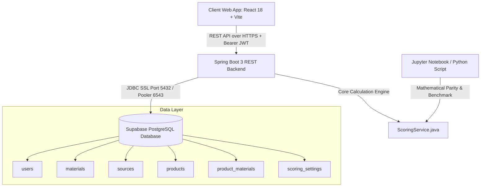

# EcoPLM: Sustainable Product Lifecycle Management Platform
### Real-Time Circularity & Recyclability Scoring Engine

**Candidate:** MANI  
**Program:** Bachelor of Technology in Biotechnology (Semester 5)  
**Project:** Mini Project 1 — Sustainable Product Lifecycle Management  

---

## 1. Project Overview

Modern bio-manufacturing and industrial design require quantitative frameworks to minimize environmental degradation, avoid landfill accumulation, and eliminate hazardous substances from consumer supply chains. 

**EcoPLM** is a full-stack engineering platform that enables engineers and designers to enter only high-level product definitions (product name, category, and constituent material weights in grams). The backend retrieves 7 stored sustainability properties per material from a curated database, calculates the aggregate circularity score in real time, and provides design recommendations alongside interactive visual analytics.

### Key Architectural Tenet
> **User inputs ONLY product name, category, and material weights.**  
> Users never input arbitrary recyclability numbers. All sustainability coefficients are retrieved from verified database records to ensure data integrity and prevent greenwashing.

---

## 2. Technology Stack

- **Frontend:** React 18, Vite, Tailwind CSS (Custom eco-friendly green token design system), Axios, React Router v6, Recharts, Lucide React.
- **Backend:** Java 21, Spring Boot 3.3.4, Spring Data JPA, Spring Security 6 (Stateless JWT), Maven.
- **Database:** PostgreSQL hosted on Supabase (Connected through JDBC over SSL, Row-Level Security protected).
- **Authentication:** Custom Spring Security + JWT authentication (Supabase is utilized purely as an isolated PostgreSQL database).
- **Analytics & Validation:** Python 3 (Pandas, NumPy, Scikit-learn, Matplotlib, SciPy).

---

## 3. System Architecture



---

## 4. Circularity Scoring Algorithm

The scoring algorithm evaluates products on a normalized $0$–$100$ scale:

### Step 1: Total Weight
$$\text{Total Weight} = \sum_{i=1}^{n} w_i$$

### Step 2: Weighted Parameter Averages
For each of the 6 positive sustainability parameters $j$:
$$\bar{v}_j = \frac{\sum_{i=1}^{n} (v_{ij} \times w_i)}{\text{Total Weight}}$$

### Step 3: Parameter Normalization to $0$–$100$
- Recyclability ($\%$) $\rightarrow$ already $0$–$100$.
- Recycled Content ($\%$) $\rightarrow$ already $0$–$100$.
- Disassembly Ease ($1$–$10$) $\rightarrow \frac{\text{rating}}{10} \times 100$.
- Reusability ($\%$) $\rightarrow$ already $0$–$100$.
- Repairability ($1$–$10$) $\rightarrow \frac{\text{rating}}{10} \times 100$.
- Lifetime (Years) $\rightarrow \min\left(\frac{\text{years}}{\text{Max Baseline Lifetime}}, 1.0\right) \times 100$.

### Step 4: Hazardous Share & Penalty
$$\text{Hazardous Share } (\%) = \left(\frac{\sum w_{\text{hazardous}}}{\text{Total Weight}}\right) \times 100$$
$$\text{Hazardous Penalty} = W_{\text{hazard}} \times \text{Hazardous Share } (\%)$$

### Step 5: Final Score & Band Classification
$$\text{Positive Score} = \sum_{j=1}^{6} (W_j \times \bar{v}_{j,\text{norm}})$$
$$\text{Final Score} = \operatorname{clamp}(\text{Positive Score} - \text{Hazardous Penalty}, 0.0, 100.0)$$

$$\text{Band} = \begin{cases} 
\text{Poor} & 0 \le \text{Score} \le 40 \\
\text{Moderate} & 41 \le \text{Score} \le 70 \\
\text{Good} & 71 \le \text{Score} \le 100 
\end{cases}$$

---

## 5. Setup & Running Instructions

### Prerequisites
- **Java 21 JDK**
- **Node.js** (v18 or higher)
- **Apache Maven**
- **Python 3.10+**

### Step A: Database Setup in Supabase
1. Create a free project at [supabase.com](https://supabase.com).
2. Open the **SQL Editor** in Supabase and run `database/schema.sql`.
3. Open a second query tab and run `database/seed.sql`.

> **Important Pre-Demo Reminder:** Free-tier Supabase projects automatically pause after 7 days of inactivity. Before a viva or evaluation demo, open your Supabase Dashboard and check that your project is **Active** (or click "Restore Project").

### Step B: Backend Configuration & Start
1. Create a `.env` file in the project root:
   ```properties
   DB_URL=jdbc:postgresql://db.<your-project-ref>.supabase.co:5432/postgres?sslmode=require
   DB_USER=postgres
   DB_PASSWORD=your_supabase_db_password
   JWT_SECRET=your_jwt_secret_key_min_256_bit
   SERVER_PORT=8080
   ```
2. In VS Code Terminal:
   ```powershell
   cd backend
   mvn spring-boot:run
   ```
   *Spring Boot will start on `http://localhost:8080`.*

### Step C: Frontend Start
In a second VS Code Terminal:
```powershell
cd frontend
npm install
npm run dev
```
*Vite will start on `http://localhost:5173`.*

### Step D: Python Validation Engine
In a third VS Code Terminal:
```powershell
cd analytics
pip install pandas numpy matplotlib scipy scikit-learn
python run_validation.py
```
*Demonstrates 100% mathematical parity with the backend and generates `benchmark_results.png`.*

---

## 6. College Viva & Demonstration Guide

Follow this 5-step walkthrough to demonstrate the system effectively during an evaluation:

### 1. Authentication & Role-Based Access
- Navigate to `http://localhost:5173/login`.
- Demonstrate the **USER** account (`mani@plm.local` / `Password@123`).
- Show that standard users can assess products and view their own history, but cannot alter underlying material coefficients.

### 2. High Circularity Assessment (Good Band)
- Go to **Calculate Score** (`/products/new`).
- Enter:
  - Name: `Circular Beverage Container`
  - Category: `Packaging & Containers`
  - Material: `Aluminium` — `180` g
- Click **Calculate Recyclability Score**.
- **Result:** Score ~ **78.0** (`Good` circularity band).
- Point out the circular progress gauge, the 100% non-hazardous composition, and the high disassembly rating.

### 3. Hazardous Product Assessment (Poor Band)
- Go to **Calculate Score** (`/products/new`).
- Enter:
  - Name: `Generic Electronic Toy`
  - Category: `Consumer Electronics`
  - Material 1: `ABS Plastic` — `100` g
  - Material 2: `Printed Circuit Board (PCB)` — `50` g (Hazardous)
  - Material 3: `Lithium-ion Battery Cell` — `50` g (Hazardous)
- Click **Calculate Recyclability Score**.
- **Result:** Score ~ **21.5** (`Poor` circularity band).
- Highlight the **Hazardous Penalty** deduction and explain the dynamic suggestion advising modular subassemblies to replace permanent adhesives.

### 4. Admin Calibration & Dynamic Weights
- Log out and log in as **ADMIN** (`admin@plm.local` / `Password@123`).
- Navigate to **Admin Console** (`/admin`).
- Show the **Live Sum Check**: Adjust any weight and show that the system prevents saving unless the 6 positive weights sum to $1.000$.
- Show the **Materials Catalog** and demonstrate bulk CSV import using `database/real_materials_dataset.csv`.

### 5. Scientific Validation Proof
- Open `analytics/scoring_validation.ipynb` or run `python run_validation.py`.
- Highlight the **100% Benchmark Agreement** across the 22 reference products.
- Present the **$\pm 10\%$ Sensitivity Analysis** showing a Spearman rank correlation coefficient of $\rho > 0.99$, proving that the ranking of sustainable products remains stable under calibration variance.

---

## 7. Default Credentials Summary

| Role | Email | Password | Access Rights |
| :--- | :--- | :--- | :--- |
| **ADMIN** | `admin@plm.local` | `Password@123` | Full access: materials CRUD, CSV bulk import, scoring settings, sources, user status |
| **USER** | `mani@plm.local` | `Password@123` | Product evaluation form, real-time score results, personal history, CSV export |
